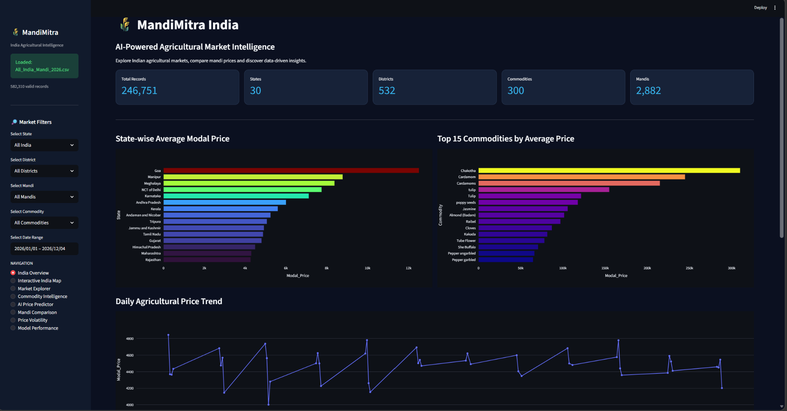
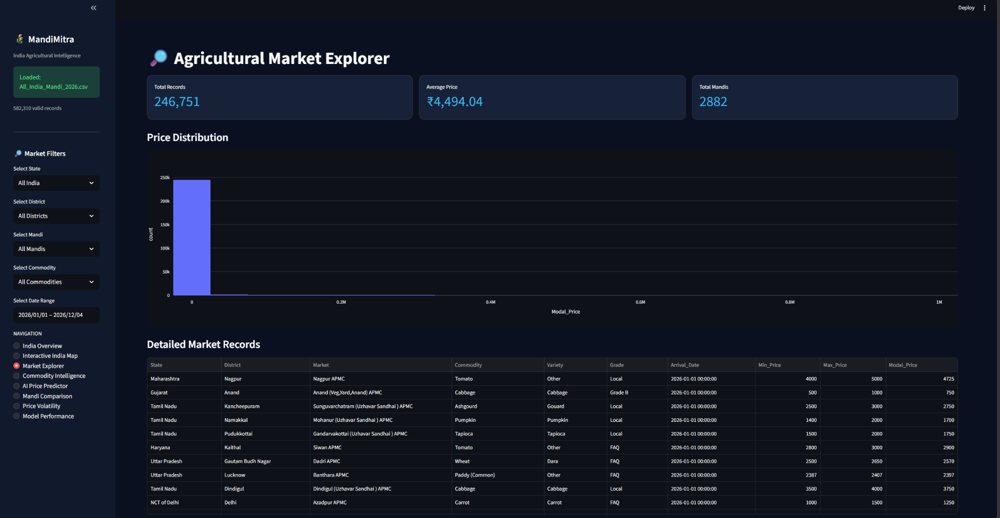
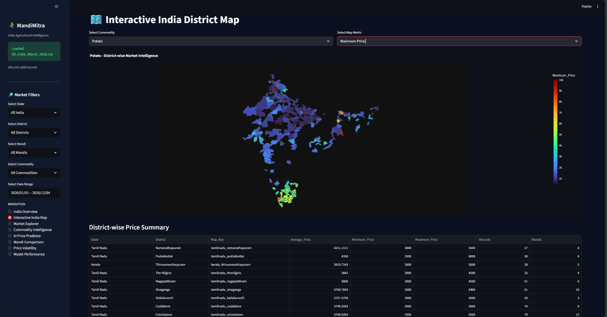
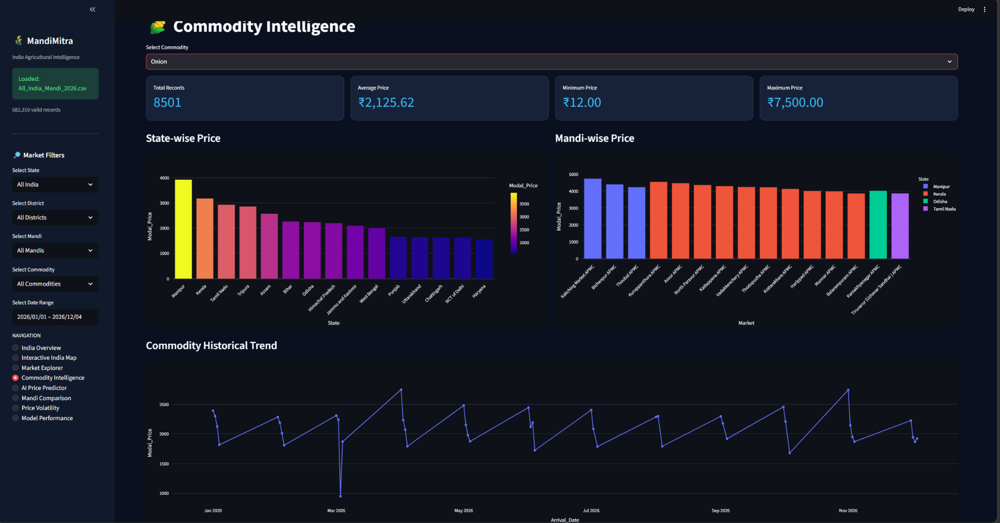
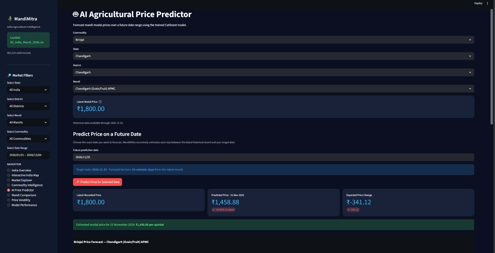
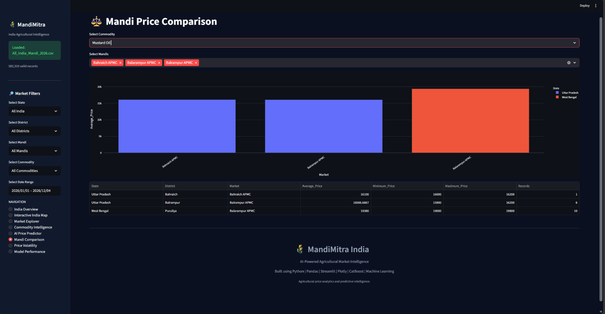
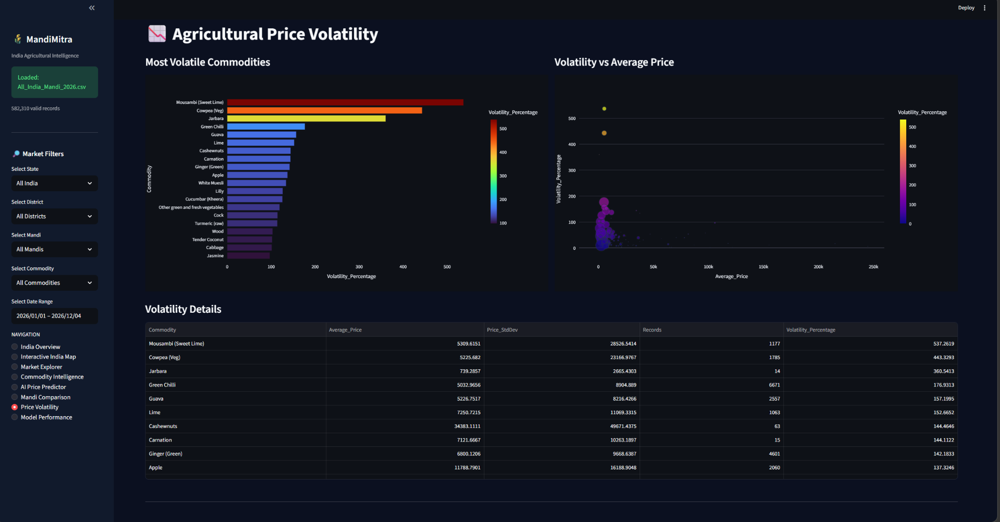

\# 🌾 MandiMitra – Agricultural Market Intelligence \& Price Prediction Platform


<p align="center">

&#x20; <strong>Empowering Indian Agriculture with Data Science, Machine Learning and Market Intelligence</strong>

</p>


<p align="center">

&#x20; 

&#x20; 

&#x20; 

&#x20; 

</p>


\---


\## 📌 Project Overview


\*\*MandiMitra\*\* is an AI-powered Agricultural Market Intelligence Platform designed to analyze agricultural commodity prices across Indian mandis.


The platform focuses on transforming agricultural market data into meaningful insights through data analytics, machine learning, interactive visualizations and price forecasting.


It aims to help farmers, researchers and agricultural stakeholders understand historical market trends, explore regional price variations and make more informed selling decisions.


\## 🎯 Problem Statement


Indian farmers often face challenges in identifying suitable markets and understanding agricultural commodity price fluctuations.


Limited access to structured market insights makes it difficult to:

\- Compare commodity prices across different mandis.

\- Understand historical price trends.

\- Identify regional market variations.

\- Estimate potential future commodity prices.

\- Make informed agricultural selling decisions.


MandiMitra addresses these challenges through an integrated data-driven market intelligence platform.


\## ✨ Key Features


\- \*\*Agricultural Price Analysis:\*\* Explore historical mandi prices and commodity market information.

\- \*\*Interactive Dashboard:\*\* Visualize agricultural market data through an interactive Streamlit interface.

\- \*\*Market Trend Analysis:\*\* Understand price movements and historical market patterns.

\- \*\*Machine Learning Models:\*\* Includes trained CatBoost, Random Forest and XGBoost model artifacts.

\- \*\*Price Prediction Research:\*\* Explore future commodity price prediction through the accompanying Jupyter Notebook.

\- \*\*Geographical Market Insights:\*\* Uses Indian geographical data in GeoJSON format for regional visualization.

\- \*\*Data Processing:\*\* Organizes agricultural datasets for analysis and machine learning workflows.


\## 🛠️ Technology Stack


| Category | Technologies |

|---|---|

| Programming Language | Python |

| Dashboard | Streamlit |

| Data Analysis | Pandas, NumPy |

| Data Visualization | Plotly |

| Machine Learning | CatBoost, Random Forest, XGBoost |

| Development Environment | Jupyter Notebook |

| Geographical Data | GeoJSON |

| Version Control | Git and GitHub |


\## 🤖 Machine Learning Models


The repository includes trained model artifacts for:


1\. CatBoost

2\. Random Forest

3\. XGBoost


These models form part of the project's agricultural price prediction workflow.


\## 📂 Project Structure


```text

MandiMitra/

│

├── app.py

│

├── data/

│   ├── commodity\_coverage.csv

│   ├── district\_commodity\_prices.csv

│   ├── district\_prices.csv

│   └── india\_interactive.geojson

│

├── datasets/

│   └── All\_India\_Mandi\_2026.csv

│

├── maps/

│   ├── india\_interactive.geojson

│   └── india\_states.geojson

│

├── models/

│   ├── catboost\_model.cbm

│   ├── categorical\_features.json

│   ├── mandimitra\_catboost.cbm

│   ├── mandimitra\_features.json

│   ├── model\_features.json

│   ├── random\_forest\_model.pkl

│   └── xgboost\_model.pkl

│

├── Project(2)\_with\_exact\_future\_date\_prediction.ipynb

│

├── ResearchIeee.pdf

│

├── .gitignore

│

└── README.md

```


\## ⚙️ Installation and Setup


\### 1. Clone the Repository


```bash

git clone https://github.com/AmanKumar9931/MandiMitra.git

```


\### 2. Navigate to the Project Directory


```bash

cd MandiMitra

```


\### 3. Create a Virtual Environment


```bash

python -m venv venv

```


Activate it on Windows:


```bash

venv\\Scripts\\activate

```


\### 4. Install Dependencies


```bash

pip install streamlit pandas numpy plotly catboost xgboost scikit-learn

```


\### 5. Run the Application


```bash

streamlit run app.py

```


The application will open in your default browser.


Default local address:


```text

http://localhost:8501

```


\## 📊 Dataset Information


The project includes agricultural market datasets organized for analysis and visualization.


The repository contains:

\- All India Mandi 2026 dataset.

\- Dashboard-oriented agricultural price data.

\- Feature-engineered datasets.

\- District-level commodity price information.

\- Commodity coverage information.

\- Geographical data for Indian market visualization.


\## 🔮 Future Scope


\- Integration of real-time mandi price information.

\- Expansion of commodity coverage.

\- Improved price forecasting models.

\- Advanced market volatility analysis.

\- Farmer-oriented market recommendations.

\- Cloud deployment and public accessibility.


\## 👨‍💻 Developer


\*\*Aman Kumar\*\*


B.Tech – Computer Science and Engineering  

Specialization: Data Science


GitHub: \[AmanKumar9931](https://github.com/AmanKumar9931)


Project Repository: \[MandiMitra](https://github.com/AmanKumar9931/MandiMitra)


\---


<p align="center">

&#x20; <strong>🌾 MandiMitra – Transforming Agricultural Data into Market Intelligence.</strong>

</p>


---

# 📸 MandiMitra Dashboard Showcase

## 1. India Overview


## 2. Agricultural Market Explorer


## 3. Interactive India District Map


## 4. Commodity Intelligence


## 5. AI Agricultural Price Predictor


## 6. Mandi Price Comparison


## 7. Agricultural Price Volatility



